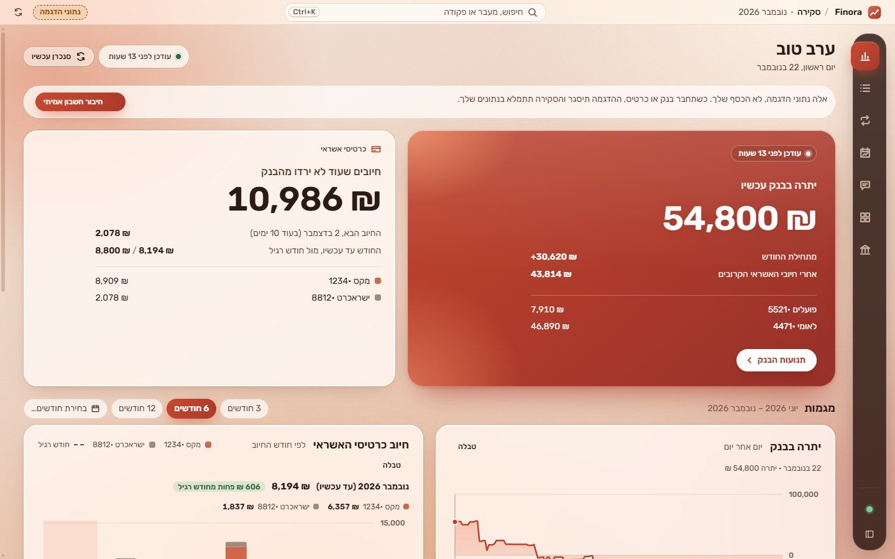
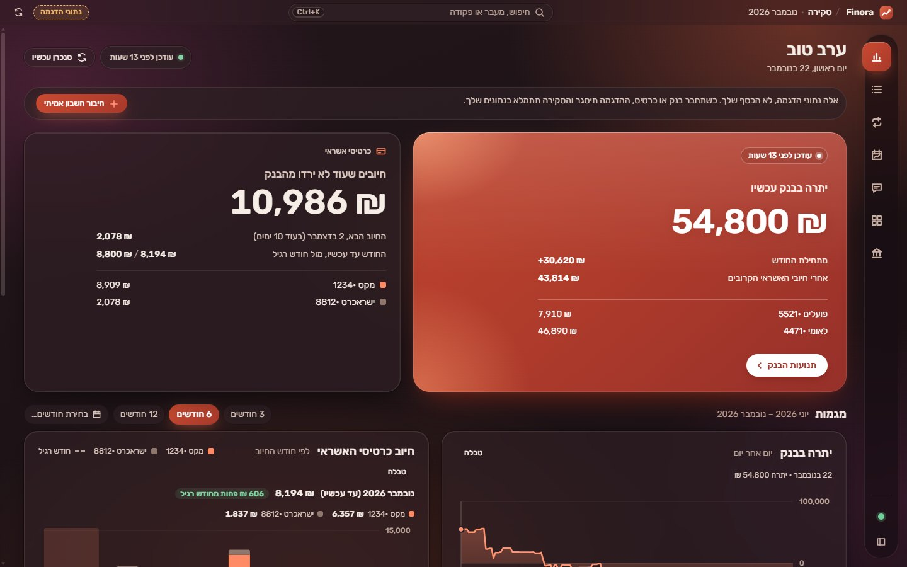
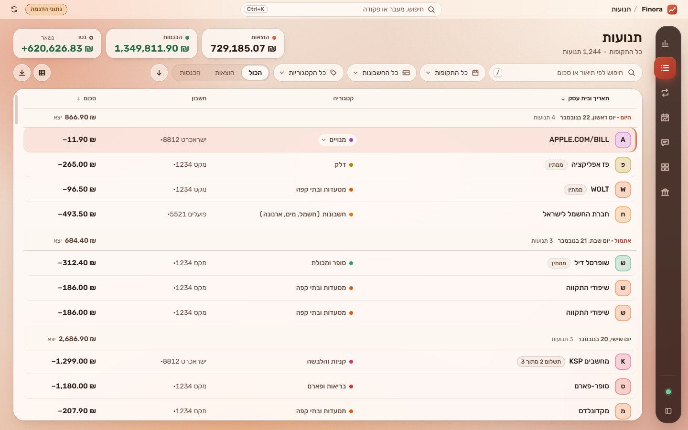
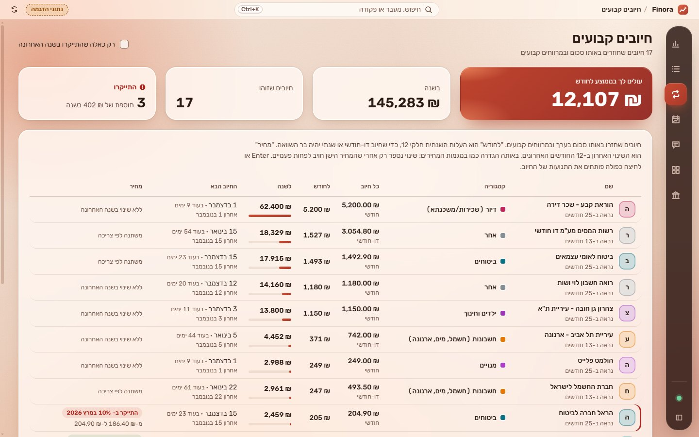
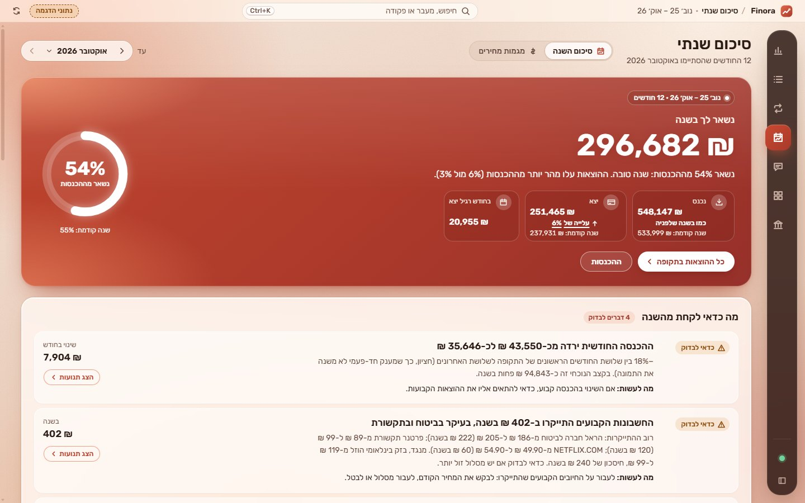
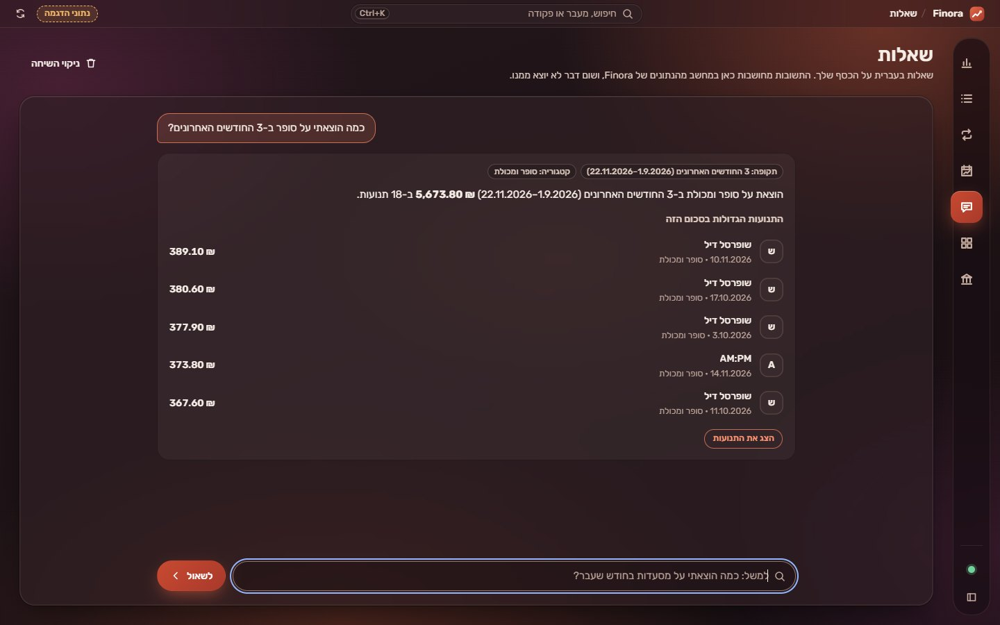
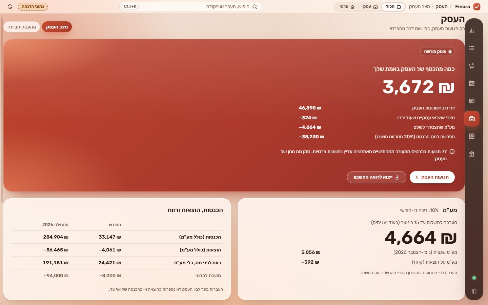

<div align="center">

# 💰 Finora

### All your money. One clear picture.
**כל הכסף שלך, תמונה אחת ברורה. רק במחשב שלך.**<br>
Your banks and credit cards in one dashboard. Local-only, encrypted, read-only.

<p>
  
  
  
  
  
  <a href="https://github.com/alonsa-93/finora/actions/workflows/ci.yml"></a>
</p>



</div>

---

<div dir="rtl">

## 📖 בעברית

**Finora** הוא דשבורד מקומי ל-Windows שמחבר את חשבונות הבנק וכרטיסי האשראי שלך ומראה בבירור איפה אתה עומד. הוא רק קורא נתונים, לא מבצע שום פעולה בחשבון, והכול נשמר מוצפן במחשב שלך בלבד.

- 🏦 **18 בנקים וחברות אשראי** בישראל, דרך `israeli-bank-scrapers`
- 📊 **דשבורד** עם היתרה בבנק עכשיו, חיובי האשראי הקרובים, מגמות ודגלים אדומים עם "מה לעשות"
- 📅 **סיכום שנתי** כסיפור אחד: כמה נשאר, לאן הלך הכסף, ומה כבר מחויב קדימה
- 🔁 **חיובים קבועים ושינויי מחירים**: מה התייקר ומה הוזל לאורך השנה
- 💬 **שאלות בעברית** על הכסף שלך, בלי מודל ובלי רשת. כל תשובה מקושרת לתנועות שמאחוריה
- 💼 **מצב עסק ופרטי**, עם מע"מ וחיבור ל-Google Sheets
- 🔒 **אבטחה**: הצפנת AES-256-GCM, מפתח שמוגן ב-Windows DPAPI, ונשמרות רק 4 הספרות האחרונות של מספרי חשבון

</div>

## 🌍 In English

**Finora** is a local Windows dashboard for Israeli bank accounts and credit cards. It only reads data, never acts on an account, and keeps everything encrypted on your own computer.

| | |
|---|---|
| 🏦 **18 Israeli banks and card companies** | via `israeli-bank-scrapers` |
| 📊 **Dashboard** | bank balance now, upcoming card charges, trends, red flags with a next step |
| 📅 **Annual review** | what was left, where the money went, what is already committed |
| 🔁 **Recurring charges and prices** | what got more expensive, what got cheaper |
| 💬 **Questions in Hebrew** | answered locally, no model, no network, linked to the exact rows |
| 💼 **Business and private modes** | VAT and a Google Sheets source |
| 🔒 **Security** | AES-256-GCM, a DPAPI-wrapped key, only the last 4 digits of account numbers |

## 📸 Screenshots
<sub>All screenshots use the built-in demo data.</sub>

| Overview (dark) | Transactions |
|---|---|
|  |  |
| **Recurring charges** | **Annual review** |
|  |  |
| **Questions in Hebrew, answered locally** | **Business mode** |
|  |  |

---

## ⚡ Quick start (try it with demo data)
Requirements: Windows 10 or 11 and [Node.js](https://nodejs.org) 24 or newer.

```powershell
git clone https://github.com/alonsa-93/finora.git
cd finora
npm ci
npm start
```

The dashboard opens in your browser with built-in **demo data**, so you can look around without connecting anything.
When you connect a real bank or card, the demo closes and your own data takes its place.
`npm start` is developer mode. For daily use, install it as described below; the installed app refuses to run from a OneDrive folder.

## 🚀 Install and run (daily use)
The app must not run from a OneDrive folder. Anything that can change files in OneDrive could change the code that handles bank credentials, so at start-up the app refuses to run from there.
1. In the project folder: `npm ci`.
2. `powershell -ExecutionPolicy Bypass -File scripts\install-local.ps1`. It:
   - copies the app (`app\`) and the stock Electron runtime (`runtime\`) to `%LOCALAPPDATA%\Programs\Finora`;
   - locks that folder (current user + SYSTEM + Administrators only);
   - creates the **Finora** shortcuts in the Start menu and on the Desktop (the Desktop shortcut is
     skipped when the Desktop folder is synced by OneDrive).

   Run it again after every update.
   The shortcut starts the server with the signed Node.js in Program Files and opens the dashboard in a
   Microsoft Edge app window (`server/index.js --app-window`). Smart App Control judges the unsigned
   electron.exe by reputation and may block it; node.exe and msedge.exe are signed.
   Closing the window stops Finora (after any running sync finishes).
3. "Start with Windows" and the tray icon belong to the Electron desktop window (the installed
   `runtime\electron.exe` running `app\`, or `npm run dev`): turn it on in Settings or from the tray icon,
   and Windows starts that Electron runtime at sign-in. The Edge app window opened by the shortcut has no
   tray icon and does not offer this switch. If Smart App Control blocks `electron.exe`, use the shortcut.

`dist/` holds an unsigned installer. With Windows Smart App Control on, it is blocked until the build is signed (see `build.win` in `package.json`, signing is not configured yet). Uninstalling asks whether to delete the data too; the default is to keep it.

## 🛠️ Development
- `npm run dev`: the desktop app from the project folder (developer mode: `--dev`, DevTools allowed).
- `npm start`: server + default browser, opened through a one-time login link. Developer mode.
- `npm test` · `npm run audit` · `npm run notices` · `npm run dist` (builds and writes `dist\SHA256SUMS.txt`).
- Install dependencies with `npm ci` only. `.npmrc` enforces exact versions, `engine-strict` and a 7-day minimum release age.
- `FINORA_DATA_DIR` and `FINORA_SMOKE_TEST` work only in developer mode.
- `FINORA_PORT` (or `PORT`) sets the server port for `server/index.js` (default 4580).
  `FINORA_QUIET=1` keeps log lines off the console (they still go to the log file).
- Developer mode (`--dev` / `FINORA_DEV=1`) is honoured only from a source checkout (`server/devmode.js`):
  never where `finora-install.json` exists (written by `install-local.ps1`), never under
  `%LOCALAPPDATA%\Programs`, and only next to a `.git` entry or the dev-only `node_modules/electron-builder`.
  The local install ignores both switches.
- Browser mode names its session cookie per port (`mc_auth_<port>`), so two instances on different
  ports never share a login.

## 🔐 Data and security
- Data lives in `%LOCALAPPDATA%\Finora`, a folder that only you and SYSTEM can open.
- Data is stored as AES-256-GCM encrypted snapshots, with one data key wrapped by Windows DPAPI.
- Bank credentials are additionally sealed per connection.
- Only the last 4 digits of account numbers are stored.
- Nothing leaves this computer except the sync with the banks themselves.
- Each sync runs in a separate short-lived process, with a browser that has no open DevTools port and leaves no profile behind.
- **Delete all data**: Settings → "אזור מסוכן" (danger zone). It deletes the encryption key first (crypto-shredding), then all files, and the app restarts as a fresh install.
- If Windows can no longer open the key (for example after a password reset by an administrator), the app offers to start over; data can be pulled again about 12 months back.

### Residual risk of the local install (unsigned, no fuses)
The local install has two ways to run, and neither is a signed Finora build:
- **The shortcut** runs `server/index.js --app-window` with the signed Node.js from Program Files and shows
  the dashboard in a Microsoft Edge app window with its own profile. Every `/api` call needs a
  per-launch session cookie, and the server listens on 127.0.0.1 only.
- **The Electron window** (used by "Start with Windows") runs the stock `electron.exe` copied into
  `runtime\`. Electron fuses can only be flipped in a build we sign, so this runtime has them all at
  their defaults.

What the app does about the Electron runtime:
- `electron/guard.mjs` is the first import of `electron/main.mjs`: it exits before Electron's API or any
  of our code loads when `ELECTRON_RUN_AS_NODE` or any `NODE_OPTIONS` is set, or an `--inspect*`,
  `--remote-debugging*`, `--js-flags` or `--debug*` switch is on the command line. `main.mjs` checks the
  Chromium switches again and refuses debugging, sandbox, proxy and certificate switches.
- What remains: Node itself parses `NODE_OPTIONS` and `--inspect` **before** any JavaScript runs, so a
  debugger port can be open for the few milliseconds until that exit (nothing of ours is loaded yet: no
  window, cookie, key or data). Only a signed build with the fuses in `package.json` (`runAsNode`,
  `enableNodeOptionsEnvironmentVariable`, `enableNodeCliInspectArguments` off) removes it.

For the shortcut, the server is an ordinary Node.js process, and Node.js honours `NODE_OPTIONS` and
debugger switches. A `.lnk` shortcut cannot clear environment variables, so in both modes anyone who can
set your user environment or start processes as you can attach to Finora. That person can already
read your files, so it is not a new boundary.

See `docs/API.md` (API contract and security model) and `docs/DESIGN.md` (design and keyboard shortcuts).


## 🤝 Contributing and security
Issues and pull requests are welcome; see [CONTRIBUTING.md](CONTRIBUTING.md).
Found a security problem? Please report it privately, as described in [SECURITY.md](SECURITY.md).

## 📄 License
Finora is free software under the GNU General Public License v3.0. See [LICENSE](LICENSE).
Third-party components keep their own licenses; see `THIRD-PARTY-NOTICES.txt`.
